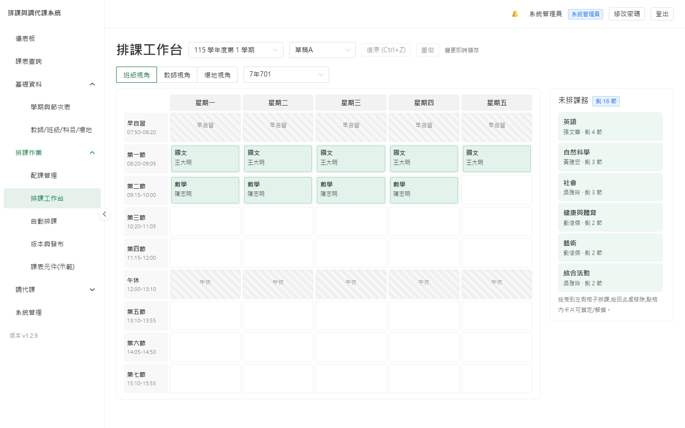
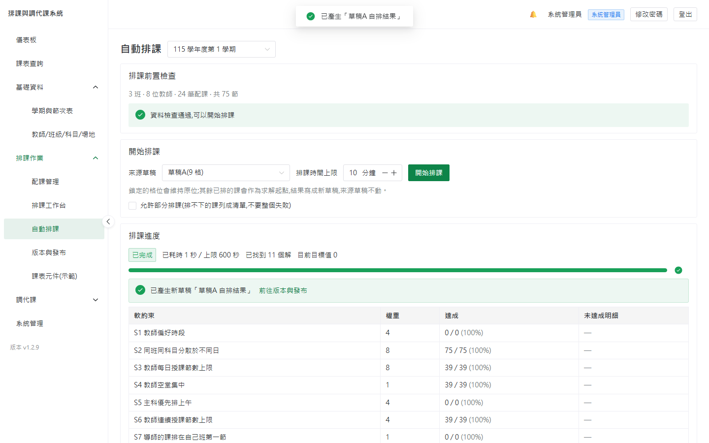
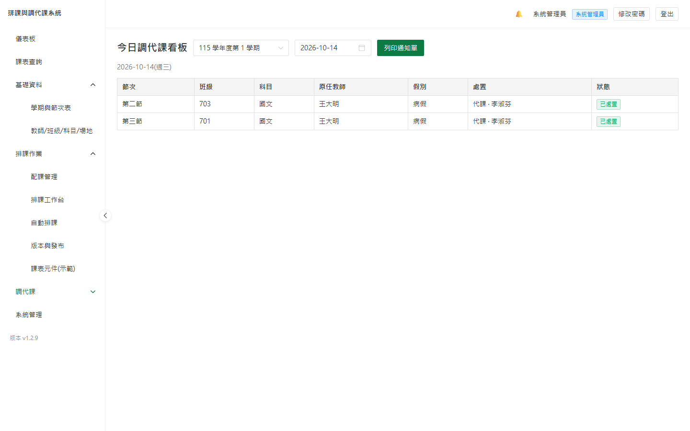
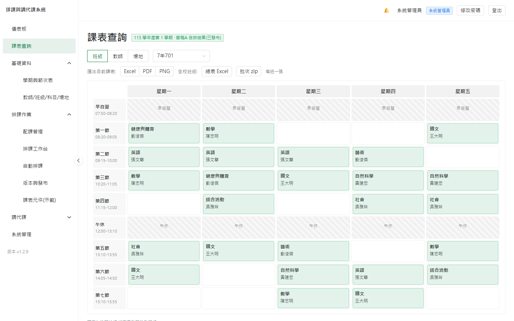

# 排課與調代課系統 · Course Scheduling System

[](https://github.com/begin0808/Course_Scheduling_System/actions/workflows/ci.yml)
[](LICENSE)

**開源免費、單校自架、純 Web 的中小學排課與調代課系統。** 適用國小、國中、普通型高中、綜合型高中、技術型高中,以**教學組長**的日常工作流程為中心設計。

從學期基礎資料、手動與自動排課(OR-Tools CP-SAT 引擎),到學期中最繁瑣的請假、代課、調課、通知與鐘點統計,一套涵蓋。以 Docker Compose 一鍵部署在校內一台主機上,資料不出校。

> **English summary:** A free, open-source (AGPL-3.0), self-hosted, web-based course-scheduling and teacher-substitution system for Taiwanese K–12 schools. It covers the school-timetabling office's full workflow: semester/period setup, manual drag-and-drop scheduling, automatic scheduling via an OR-Tools CP-SAT engine with human-readable conflict explanation, and the day-to-day of leave requests, substitute assignment, notifications, and substitution-hour reporting. One school, one self-hosted deployment (no multi-tenant SaaS). One-command Docker Compose install. UI is Traditional Chinese with Taiwan educational terminology.

---

## 功能總覽

| 領域 | 內容 |
|---|---|
| **基礎資料** | 學期/節次表(多學制範本)、教師/班級/科目/場地、Excel 匯入、設定精靈、開新學期複製、混合學制(班級↔節次表指派) |
| **配課與手動排課** | 配課管理(跑班群組、協同教學、連堂)、鐘點即時統計、拖拉式週課表、單格衝突檢查(<100ms)、多草稿版本管理與發布 |
| **自動排課** | OR-Tools CP-SAT 引擎,H1–H10 硬約束 + S1–S8 軟約束加權;背景求解含即時進度;**無解時以教務語言定位衝突**並支援部分排課 |
| **調代課** | 請假登記與受影響節次展開、代課推薦引擎、調課驗證、指派即生效、站內+Email 通知與確認、今日看板與 A4 公告列印、月結鐘點統計(Excel) |
| **報表/匯出** | 班級/教師/場地課表匯出 Excel / PDF(內嵌中文字型)/ PNG、全校總表、批次 zip |
| **維運** | 每日自動備份 + 手動備份 / 下載 / 上傳還原(還原前自動保護、還原後強制重登)、稽核紀錄、RBAC(管理員/主任/組長/教師) |

---

## 快速開始

需先安裝 [Docker](https://docs.docker.com/get-docker/)。**完整步驟(含 Windows / Linux / NAS)見 [部署手冊](docs/deploy/README.md)。**

### 一鍵安裝腳本(最簡單)

下載後執行,回答校名、管理員密碼、埠號三個問題即可。金鑰自動產生、埠號衝突自動閃開,不必手改 `.env`。

**Windows(PowerShell)**:

```powershell
Invoke-WebRequest https://raw.githubusercontent.com/begin0808/Course_Scheduling_System/main/install.ps1 -OutFile install.ps1
.\install.ps1
```

**Linux / macOS / NAS**:

```bash
curl -fLO https://raw.githubusercontent.com/begin0808/Course_Scheduling_System/main/install.sh
bash install.sh
```

> 刻意設計成「先下載、再執行」而非 `curl | sh`——這是要進學校主機的東西,請先打開看過內容。

### 拉取官方映像(推薦)

```bash
mkdir scheduling && cd scheduling
curl -fLO https://raw.githubusercontent.com/begin0808/Course_Scheduling_System/main/docker-compose.yml
curl -fL  https://raw.githubusercontent.com/begin0808/Course_Scheduling_System/main/.env.example -o .env
# 編輯 .env:改 ADMIN_PASSWORD、SCHOOL_NAME、SECRET_KEY
docker compose pull
docker compose up -d
```

> **Windows 使用者**:上面是 bash 語法,PowerShell 的 `curl` 是 `Invoke-WebRequest` 的別名、
> 吃不懂 `-fLO`。請改用[安裝指南](docs/deploy/install.md)裡的 PowerShell 版本下載指令。

### 從原始碼建置

```bash
git clone https://github.com/begin0808/Course_Scheduling_System.git
cd Course_Scheduling_System
cp .env.example .env      # 改 ADMIN_PASSWORD、SCHOOL_NAME、SECRET_KEY
docker compose up -d      # 首次會建置映像,需數分鐘
```

啟動後開瀏覽器連 `http://<主機IP>`(本機為 <http://localhost>),以 `.env` 的管理員帳密登入,依設定精靈完成建置。

**想先試看看?** 還沒建學期時,到「系統管理 → 示範資料」按一下,會建出一所完整的虛構國中(18 班、48 位教師、384 筆配課),十幾秒就能跑出全校課表——不必先手 key 資料就能把排課、調代課、匯出、備份整套流程走過一遍。

- 健康檢查:`http://localhost/api/health` → `{"status":"ok"}`
- 容器狀態:`docker compose ps`(六個容器皆應 healthy)

### 硬體最低需求

2 核 / 4GB RAM / 10GB 磁碟(自動排課建議 4 核 8GB)。支援 x86-64 與 ARM64(NAS / 樹莓派)。

---

## 畫面

| 排課工作台(拖拉排課、三視角、即時衝突) | 自動排課(進度、軟約束達成度) |
|---|---|
|  |  |

| 今日調代課看板(可列印 A4 通知單) | 課表查詢與匯出(Excel / PDF / PNG) |
|---|---|
|  |  |

完整逐章圖解見[教學組長操作手冊](https://begin0808.github.io/Course_Scheduling_System/)。

---

## 文件

| 文件 | 內容 |
|---|---|
| [**教學組長操作手冊**](https://begin0808.github.io/Course_Scheduling_System/)（[原始檔](docs/index.html)） | 給使用者:設定精靈、配課、排課、調代課、匯出、備份、FAQ(11 章圖文網頁) |
| [**功能總覽**](https://begin0808.github.io/Course_Scheduling_System/features.html)（[原始檔](docs/features.html)） | 目前版本的全部功能、已知限制與規劃中項目(一頁看完) |
| [部署手冊](docs/deploy/README.md) | 給安裝者:安裝、升級、備份、網域 HTTPS、FAQ |
| [架構設計](docs/architecture.md) | 需求、資料模型、排課引擎、技術棧(規格權威來源) |
| [開發任務卡](docs/tasks.md) | Milestone 與逐卡實作紀錄 |
| [變更紀錄](CHANGELOG.md) | 各版本變更 |
| [貢獻指南](CONTRIBUTING.md) | 開發環境、程式風格、測試、發布流程 |

> **離線閱讀**:上表 `docs/` 下的每份 `.md` 都有一份對應的 `.html`(如 `docs/deploy/install.html`),
> 附側邊目錄與深/淺色切換,雙擊即可用瀏覽器開,不必連網、不必裝軟體——機房裡沒網路時特別好用。
> 這些 HTML 由 `python scripts/build_docs.py` 從 Markdown 產生,**請勿直接編輯**;改完 `.md` 重跑一次即可。

---

## 技術棧

| 層 | 技術 |
|---|---|
| 前端 | Vue 3 + TypeScript + Vite + Pinia + Naive UI |
| 後端 | Python 3.12 + FastAPI + SQLAlchemy 2 + Pydantic v2 |
| 排課引擎 | Google OR-Tools CP-SAT(RQ + Redis 背景執行) |
| 匯出 | openpyxl(Excel)、WeasyPrint(PDF,內嵌 Noto CJK)、poppler(PNG) |
| 資料庫 | PostgreSQL 16 |
| 反向代理 | Caddy(內網 HTTP;設網域即自動 HTTPS) |
| 部署 | Docker Compose(6 容器:web / api / worker(排課)/ worker-ops(匯出·備份·定時)/ postgres / redis) |

---

## 專案狀態

**v1.4.2 已發行(2026-10-30)。** 六大里程碑 M0–M5 全部完成,功能齊備並經完整驗收(後端 718 項單元/整合測試、57 項 Playwright 端對端測試涵蓋全部 20 個頁面,每次提交皆對真實 Docker 全棧跑過)。官方映像(amd64 + arm64)已發布於 GHCR。

v1.4.2 可以**補登**事後才登記的請假(已經過去的節次補登代課,不通知老師、列入鐘點統計);v1.4.1 起改採 **AGPL-3.0 授權**(見下方「授權」;功能與資料都沒有變動);v1.4.0 新增**代導**(導師請假當天由誰代他帶班,當天沒課也算、半天也算;可印代導通知單,月結分開記全天與半天天數;⚠️ 資料表結構變更,升級前會自動備份);v1.3.5 修正**併班**選不到老師(改列出這一節正在上課的老師),調課單加上記號說明;v1.3.4 讓跑班群組、導師、任教科目等下拉選單都能**打字搜尋**;v1.3.3 的儀表板新增**即時概況**(現在這一節各班在上什麼課、誰在上,已套用當天的調代課);v1.3.2 新增**重設管理員密碼**的指令(忘了密碼或第一次就登不進去時,不必刪資料或還原備份);v1.3.1 新增**帳號管理**(系統管理員可設定教學組長、教務主任的帳號);v1.3.0 支援**單雙週課程**(同一節單週、雙週輪流上不同的課,排課、請假代課、調課、巡堂表、鐘點都分單雙週;⚠️ 首次改動資料表結構,升級前請先備份);v1.2.19 支援**日薪代課**(國小常見:月結統計把鐘點與日薪分開列)並可**整批指派代課**(整張假單或整天一次派給同一位老師);v1.2.18 可**檢查課表**(發布前列出衝堂、教師不可排時段等衝突;事後修改不可排時段時當場提示已排的課);v1.2.17 修正登入按一次送出兩筆請求(輸錯密碼約第 3 次就被鎖定);v1.2.15、v1.2.16 修正跑班群組的兩個問題(同一位老師在群組裡重複配課時自動排課會排出撞課的課表;同一格有多筆同科目配課時,手動排課把每日節數重複計算);v1.2.12~v1.2.14 可列印**巡堂表**並匯出 Excel(依當天的調代課結果產生,社團另出分組巡堂單);v1.2.10、v1.2.11 讓**國中小、完全中學**跨部上課的老師,課表與通知單都標出實際上課時間,兩部節數不同(國中七節、高中八節)也不會漏課;v1.2.9 可一次匯出**全校教師課表**(總表與批次打包);v1.2.8 可用 Excel **批次更新既有教師**(新學年職務異動),並能**停用/啟用教師登入帳號**(離職教師保留歷史紀錄又進不來);v1.2.7 補上**學期起訖日期**的填寫與修改(先前畫面上無處可填,導致請假被擋);v1.2.6 修掉第一批外部使用者回報的三個問題(教師帳號首次登入卡死、無法事後補開教師帳號、未排課務清單過長時拖不動),並可在畫面上自行修改與重設密碼;v1.2.5 可列印**教師代課通知單與班級代課通知單**(照學校紙本格式,代課時可選計費方式);v1.2.4 的調代課處理會寫出處置方式(代課或調課、哪天補課);v1.2.3 起系統會顯示目前版本,並在有新版時提醒系統管理員(只提醒、不自動升級);v1.2.2 可列印**教師調課通知單與班級調課通知單**(照學校紙本格式);v1.2.1 補上**調課**的操作畫面——請假(含研習)的節次可直接列出雙方都有空的對調節次,支援跨週(最多四週)與連堂,補課日也會出現在今日看板。v1.2.0 起另有**一鍵示範資料**,裝好後兩分鐘內就能看到一張排好的全校課表。

**請直接從最新版開始安裝**(見上方快速開始);`v1.4.2` 是目前建議使用的版本。各版變更見 [CHANGELOG](CHANGELOG.md),開發歷程見 [docs/tasks.md](docs/tasks.md)。

系統仍在實際校園環境試用中,若你是第一批使用者,歡迎加入 [LINE 社群](https://line.me/ti/g2/hP0Lg7mqvE5rvWg0sE9MHI-QsLkd94Cfp3wKcg) 或透過 [Issues](https://github.com/begin0808/Course_Scheduling_System/issues) 回報任何問題。

---

## 回報問題與意見回饋

發現錯誤、有功能建議,或想分享貴校的使用經驗,都非常歡迎:

- **LINE 社群「排課與調代課系統｜使用者交流」**:[點此加入](https://line.me/ti/g2/hP0Lg7mqvE5rvWg0sE9MHI-QsLkd94Cfp3wKcg)(可用暱稱加入)。使用上的問題可以直接在群組提問,其他學校的老師也能一起交流;**新版發布會在群組公告**(改了什麼、要注意什麼、怎麼升級)。

  

- **回報問題 / 提出建議**:於本專案開 [GitHub Issue](https://github.com/begin0808/Course_Scheduling_System/issues)(附上操作步驟與 `docker compose logs` 片段會更快解決)
- **來信聯絡**:專案開發者 **國立南大附中 李佳恩老師** — [begin0808@gmail.com](mailto:begin0808@gmail.com)

這套系統是為第一線教學組長而寫的,你的實際使用回饋對它的改進最有幫助。

## 授權

自 **v1.4.1** 起採用 [GNU Affero 通用公共授權第 3 版](LICENSE)(AGPL-3.0-only),之後的版本都採用 AGPL-3.0。
Copyright (C) 2026 國立南大附中 李佳恩 與本專案貢獻者。

- **學校自架、使用、修改都免費**,不需要申請,也沒有使用人數或年限的限制。
- **修改後再提供給別人使用時,必須公開修改後的完整原始碼**,而且同樣採用 AGPL-3.0。不論是把程式交給別人,還是架成網站讓其他學校從網路上使用,都算「提供給別人使用」。
- 這樣規定是為了讓所有改良都能回饋給每一所學校,不會被包裝成封閉的商業產品販售。
- 系統的登入頁與側邊欄有「原始碼」連結。修改過程式再提供給別人使用的人,請把連結改成自己修改後的原始碼位置(`frontend/src/api/system.ts` 的 `SOURCE_URL`)。

**v1.4.0 以前(含)的版本以 MIT 授權發布**,那些版本仍照 MIT 使用;v1.4.1 起的新版本適用 AGPL-3.0。

執行時使用的第三方元件與其授權見 [THIRD-PARTY-NOTICES.md](THIRD-PARTY-NOTICES.md)(皆與 AGPL-3.0 相容)。
